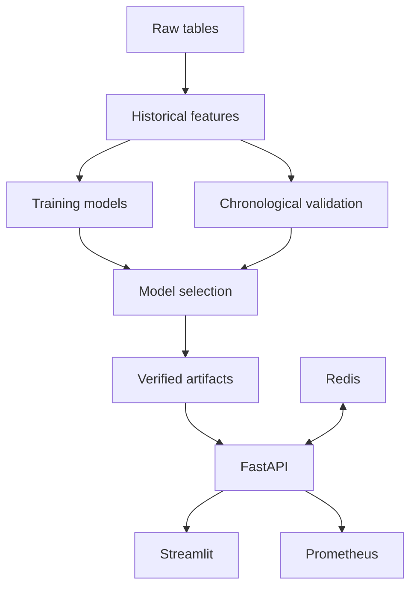
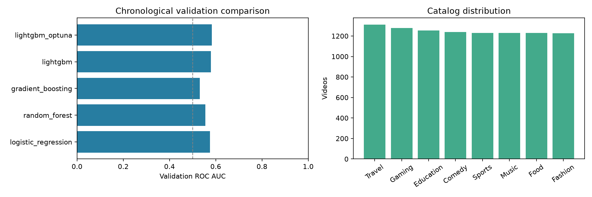

# YouTube Shorts Recommendation System

[](https://github.com/yawen891115/youtube-recommendation-system-project/actions/workflows/ci.yml)

An end-to-end machine learning project for short-video engagement prediction and recommendation: validated interaction data, historical features, chronological model evaluation, a FastAPI service, and an English Streamlit dashboard.

**10,000 users · 10,000 videos · 100,000 interactions · 167 features**

The repository includes the complete supplied raw dataset, regenerated feature data, trained model artifacts, experiment records, the original English assignment, tests, and deployment files. It consolidates the latest substantive implementation from the supplied project versions and completes the missing service and deployment components. [Version selection](docs/version-audit.md) records the comparison.

## What the system does

- Builds timestamp-aware user/video histories, sessions, categorical features and 50-dimensional user and video SVD embeddings.
- Compares Logistic Regression, Random Forest, Gradient Boosting and LightGBM; tunes LightGBM with Optuna and records runs with MLflow.
- Predicts like probability **after an observed watch duration** through single and batch APIs.
- Ranks unseen videos **before playback** with a separate model that excludes observed watch and completion features.
- Serves an English UI with CSV upload/download, recommendation results, request trends, latency, errors and model feature importance.
- Adds Redis caching, request limits, Prometheus metrics, health checks and a five-service Docker Compose deployment.



## Run the complete demo

Docker Compose starts the included trained model without a training step:

```bash
git clone https://github.com/yawen891115/youtube-recommendation-system-project.git
cd youtube-recommendation-system-project
docker compose up --build -d --wait
python scripts/smoke_test.py --stack
```

This repository is private; cloning requires an authorized GitHub account. Services bind to the local machine.

| Service | Address |
| --- | --- |
| Streamlit demo | http://localhost:8501 |
| Interactive API documentation | http://localhost:8000/docs |
| Health check | http://localhost:8000/health |
| MLflow experiments | http://localhost:5000 |
| Prometheus | http://localhost:9090 |

Stop with `docker compose down`. Named volumes preserve Redis, MLflow and Prometheus data; `docker compose down -v` intentionally removes those runtime volumes. See [deployment details](docs/deployment.md).

## Run with Python

Use Python 3.12. Linux needs the system OpenMP runtime (`libgomp1`); macOS may need `brew install libomp` for LightGBM.

```bash
python3.12 -m venv .venv
source .venv/bin/activate
pip install -r requirements-lock.txt
python -m src.data_validation
uvicorn src.api:app --host 127.0.0.1 --port 8000
```

In another activated terminal:

```bash
streamlit run streamlit_app.py
```

Redis is optional for a single local process: the API uses a bounded in-memory cache and rate limiter if Redis is unavailable. Set `REDIS_URL=redis://localhost:6379/0` to use Redis. The shared Redis backend is required for consistent limits across multiple API processes.

## Reproduce the experiment

```bash
python -m src.train --trials 5
pytest -q
ruff check .
ruff format --check .
```

Training uses all 100,000 records, seed 42, and chronological **64,000 / 16,000 / 20,000** train/validation/test partitions. Increasing `--trials` runs a larger Optuna search. An optional `--sample-size` is for development only and replaces artifacts in the specified output directories; use separate directories for sample runs.

The feature pipeline is fitted on training data. Prefix histories exclude the current record and all later events. Validation and test use the frozen training-history snapshot. SVD is fitted on the first 10% of training events; those warmup events receive zero embeddings. The original assignment also asks for stratification; this implementation preserves the strict time boundaries and reports class proportions instead of shuffling events across time.

The original 196 MB feature CSV was a stale generated artifact. The rebuilt table is included as both `data/processed_interactions.csv.xz` and `data/processed_interactions.parquet`. To obtain the assignment's uncompressed CSV:

```bash
python -c "import lzma, shutil; src=lzma.open('data/processed_interactions.csv.xz','rb'); dst=open('data/processed_interactions.csv','wb'); shutil.copyfileobj(src,dst); src.close(); dst.close()"
```

## Results and interpretation

See the generated [experiment report](reports/experiment-report.md) and [machine-readable results](reports/training_results.json) for exact measurements and model comparisons.



The supplied data has a low positive rate and limited predictive signal. High majority-class accuracy is not evidence of a strong recommender. The report includes AUC, average precision, precision, recall, F1 and Brier score. No online CTR uplift, production throughput, or latency target is claimed. The 0.5 classification threshold is not optimized, and the returned confidence label is a distance-from-0.5 heuristic, not calibrated certainty.

The raw catalog also contains interactions dated before video upload; these records remain in the supplied tables and are counted in [data exploration](reports/data-exploration.md). Catalog metadata is treated as a static snapshot. The source materials do not establish that these records are live YouTube traffic.

## API examples

```bash
curl -X POST http://localhost:8000/predict \
  -H 'Content-Type: application/json' \
  -d '{"user_id":"user_1","video_id":"video_1","watch_time":20,"hour_of_day":12}'

curl -X POST http://localhost:8000/predict/batch \
  -H 'Content-Type: application/json' \
  -d '{"instances":[{"user_id":"user_1","video_id":"video_1","watch_time":20}]}'

curl -X POST http://localhost:8000/recommend \
  -H 'Content-Type: application/json' \
  -d '{"user_id":"user_1","top_k":10}'
```

Prediction responses contain probability, confidence, cold-start status, model version, latency, timestamp and cache status. Batch requests accept 1–256 instances. The UI chunks CSV files up to 5,000 rows. IDs must match `user_<digits>` / `video_<digits>`. Unknown valid IDs use cold-start features. Optional timestamps must include a timezone; an accompanying `hour_of_day` must agree with their UTC hour. Recommendations exclude videos seen in training history and videos not uploaded by the request time; they rank up to 300 candidates.

| Endpoint | Purpose |
| --- | --- |
| `GET /health` | Readiness and cache backend; HTTP 503 if the model failed to load |
| `GET /model/info` | Model version, feature schema, importance and evaluation metrics |
| `POST /predict` | Observed-watch engagement probability |
| `POST /predict/batch` | Batch engagement prediction |
| `POST /recommend` | Pre-watch ranking of unseen videos |
| `GET /monitoring` | Bounded recent request history and dashboard metrics |
| `GET /metrics` | Prometheus counters and latency histograms |

## Repository guide

| Path | Contents |
| --- | --- |
| `src/data_validation.py` | Schemas, data checks and chronological split |
| `src/feature_engineering.py` | Shared historical features and SVD artifacts |
| `src/train.py` | Baselines, early stopping, Optuna, MLflow and reports |
| `src/inference.py` | Verified artifact loading and inference |
| `src/api.py`, `src/cache.py` | HTTP service, Redis cache, limits and monitoring |
| `streamlit_app.py` | English interactive demo |
| `data/` | All three original tables and rebuilt processed data |
| `models/` | Selected classifier, pre-watch ranker and feature artifacts |
| `experiments/mlflow.db` | Recorded experiments, parameters and metrics |
| `reports/` | EDA, comparisons, tuning trials and experiment exports |
| `tests/` | Feature, API, Redis fallback, validation and UI checks |
| `docs/assignment-original.en.md` | Original English assignment, unchanged |
| `docs/requirements-coverage.md` | Requirement-to-implementation mapping |
| `docs/version-audit.md` | Source-version comparison and selection evidence |
| `Dockerfile`, `Dockerfile.train` | CPU serving and CUDA-based training environments |
| `.github/workflows/ci.yml` | Unit checks and actual Compose service smoke tests |

Model files are loaded only after SHA-256 verification against `models/metadata.json`. Treat joblib/pickle files as trusted executable artifacts; retrain from this repository rather than loading arbitrary model uploads. The demo has no user authentication and is intended for local review, not direct public hosting.
