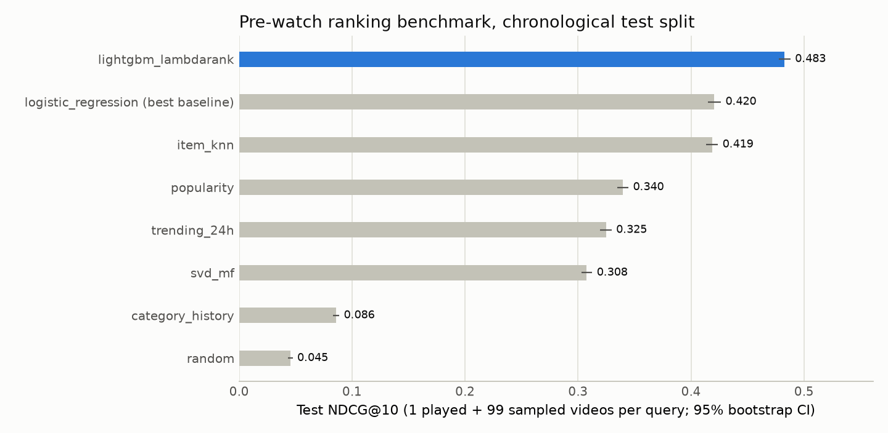
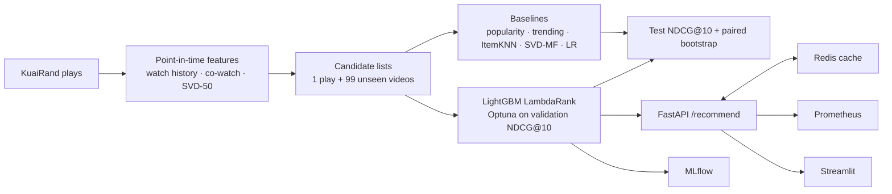

# YouTube Shorts-style Video Recommendation

[](https://github.com/yawen891115/youtube-recommendation-system-project/actions/workflows/ci.yml)

An end-to-end short-video recommender trained on **100,000 real user-video plays** from the Kuaishou
app (KuaiRand-Pure): point-in-time watch-history features, 50-D SVD embeddings, a **LightGBM
LambdaRank** ranker benchmarked against standard baselines on a time-based split, and a
monitored serving stack (FastAPI, Redis, MLflow, Prometheus, Streamlit) in five Docker services.

## Results

Offline ranking on the chronological **64,000 / 16,000 / 20,000** split (train / validation / test plays).
Each test query is one first-time play ranked against 99 unseen videos that were already
uploaded at that time; the test split (19,942 queries) was scored once,
after all choices were made on validation.

| | Test NDCG@10 |
| --- | ---: |
| Best baseline, chosen on validation (`logistic_regression`) | 0.420 |
| **LightGBM LambdaRank ranker** | **0.483** |
| Difference, paired bootstrap (10,000 resamples over 19,942 queries) | +0.062 [95% CI +0.059, +0.066], p < 0.001 |

Serving: `/recommend` p95 **19.7 ms** for an uncached request that ranks 300 candidates (one client), measured against the running stack; see the latency table below.

Full benchmark (95% bootstrap confidence intervals):

| Model | Family | Validation NDCG@10 | Test NDCG@10 [95% CI] | Test HR@10 |
| --- | --- | ---: | ---: | ---: |
| **lightgbm_lambdarank** (final) | Tree ensemble (learning to rank) | 0.528 | 0.483 [0.478, 0.488] | 0.744 |
| logistic_regression (best baseline) | Linear | 0.498 | 0.420 [0.415, 0.426] | 0.625 |
| item_knn | Collaborative filtering | 0.462 | 0.419 [0.414, 0.424] | 0.675 |
| popularity | Heuristic | 0.355 | 0.340 [0.335, 0.345] | 0.583 |
| trending_24h | Heuristic | 0.372 | 0.325 [0.319, 0.330] | 0.523 |
| svd_mf | Collaborative filtering | 0.370 | 0.308 [0.303, 0.313] | 0.511 |
| category_history | Content-based | 0.091 | 0.086 [0.083, 0.089] | 0.183 |
| random | Reference | 0.046 | 0.045 [0.043, 0.047] | 0.100 |

Ablations of the final ranker (same tuned parameters, one change each):

| Variant | Test NDCG@10 | Final minus variant (paired bootstrap) |
| --- | ---: | ---: |
| pointwise binary objective | 0.485 | -0.0023 [-0.0042, -0.0005], p 0.014 |
| without user watch history | 0.380 | +0.1028 [+0.0985, +0.1071], p < 0.001 |
| without svd embeddings | 0.478 | +0.0052 [+0.0031, +0.0072], p < 0.001 |

Details: [ranking report](reports/ranking-report.md) · [ranking_results.json](reports/ranking_results.json) ·
[data exploration](reports/data-exploration.md) · [like-classifier report](reports/experiment-report.md) ·
[latency report](reports/latency.md).



## Data

`data/` holds a reproducible 100,000-play subset of **KuaiRand-Pure** (Gao et al., CIKM 2022;
CC BY-SA 4.0): 4,088 users, 7,583 catalog videos, plays from
2022-04-09 to 2022-05-08, with watch time, likes,
shares and long views. `scripts/prepare_kuairand.py` rebuilds it from the official archive; the
subset rules and column mapping are in [data/README.md](data/README.md).

## How it works



- **Features** (`src/feature_engineering.py`): every feature for a request at time *t* uses only
  plays strictly before *t*. Watch-history features cover the user (watch time, likes, long views,
  sessions, recency), the user's history in the candidate's category and with its creator
  (time-decayed), item-to-item co-watch similarity with the user's earlier plays (leave-user-out on
  training rows), and video popularity / 24-hour trend. 50-D user and video SVD embeddings come
  from the first 10% of training plays only. Learned inputs (priors, scaler, SVD, co-watch
  counts) use training plays only.
- **Ranking benchmark** (`src/ranking.py`, `src/train_ranker.py`): popularity, 24-hour trending,
  category history, ItemKNN, SVD matrix factorisation and logistic regression on the same features;
  LightGBM LambdaRank tuned with Optuna; best baseline and hyperparameters chosen on validation;
  95% bootstrap intervals and a paired bootstrap test on test queries; MLflow run per model.
- **Like classifier** (`src/train.py`): the original post-watch engagement model (LR, RF, GB,
  LightGBM + Optuna) behind `/predict`.
- **Serving** (`src/api.py`, `src/inference.py`): retrieval of up to 300 unseen, already-uploaded
  videos (the user's top categories first, then popularity), LambdaRank scoring, Redis response
  cache and rate limit, and Prometheus latency, error and cache metrics with recording and alert rules
  (`monitoring/rules.yml`).

## Run the stack

```bash
git clone https://github.com/yawen891115/youtube-recommendation-system-project.git
cd youtube-recommendation-system-project
docker compose up --build -d --wait
python scripts/smoke_test.py --stack
```

| Service | Address |
| --- | --- |
| Streamlit demo | http://localhost:8501 |
| API docs | http://localhost:8000/docs |
| MLflow | http://localhost:5000 |
| Prometheus | http://localhost:9090 |
| Redis | internal |

The data ends in May 2022, so requests without a timestamp replay `REPLAY_TIME`
(default `2022-05-08T16:00:00Z`). Stop with `docker compose down` (`-v` also removes volumes).

```bash
curl -X POST http://localhost:8000/recommend -H 'Content-Type: application/json' \
  -d '{"user_id":"user_16","top_k":10,"timestamp":"2022-05-08T16:00:00Z"}'
```

## API

| Endpoint | Purpose |
| --- | --- |
| `GET /health` | Readiness and cache backend; HTTP 503 if the model failed to load |
| `GET /model/info` | Versions, feature schema, ranking benchmark, ablations, feature importance |
| `POST /recommend` | Pre-watch ranking of unseen videos (retrieval + LambdaRank), Redis-cached |
| `POST /predict` | Like probability after an observed watch duration (classifier) |
| `POST /predict/batch` | Batch like prediction (1-256 instances) |
| `GET /monitoring` | Recent requests, p50/p95 latency, error rate, cache hit ratio |
| `GET /metrics` | Prometheus metrics: latency histograms, errors, cache hits/misses, model time |

```bash
curl -X POST http://localhost:8000/predict -H 'Content-Type: application/json' \
  -d '{"user_id":"user_16","video_id":"video_1","watch_time":20,"timestamp":"2022-05-08T16:00:00Z"}'
curl -X POST http://localhost:8000/predict/batch -H 'Content-Type: application/json' \
  -d '{"instances":[{"user_id":"user_16","video_id":"video_1","watch_time":20}]}'
```

IDs must match `user_<digits>` / `video_<digits>`; unknown valid IDs are served as cold start
(history features empty). Timestamps must include a timezone. Recommendations exclude videos the
user already played and videos not yet uploaded at the request time.

## Reproduce

Python 3.12 (`libgomp1` on Linux, `brew install libomp` on macOS):

```bash
python3.12 -m venv .venv && source .venv/bin/activate
pip install -r requirements-lock.txt
python scripts/prepare_kuairand.py --download   # optional: rebuild data/ from the source
python -m src.train                              # about 26 minutes on 2 CPU cores
pytest -q && ruff check . && ruff format --check .
```

Latency benchmark against a running API (start it with a high request limit):

```bash
REQUESTS_PER_MINUTE=1000000 CACHE_TTL_SECONDS=600 uvicorn src.api:app --port 8000
python scripts/benchmark_latency.py --requests 1000 --concurrency 1 4 8
```

| Path | Concurrent clients | p50 | p95 | p99 | Throughput |
| --- | ---: | ---: | ---: | ---: | ---: |
| `/recommend`, Redis cache miss (rank 300 candidates) | 1 | 15.5 ms | 19.7 ms | 23.0 ms | 62 req/s |
| `/recommend`, Redis cache hit | 1 | 2.1 ms | 2.6 ms | 3.9 ms | 436 req/s |
| `/recommend`, Redis cache miss (rank 300 candidates) | 4 | 44.3 ms | 62.9 ms | 76.1 ms | 88 req/s |
| `/recommend`, Redis cache hit | 4 | 5.5 ms | 6.4 ms | 7.9 ms | 617 req/s |
| `/recommend`, Redis cache miss (rank 300 candidates) | 8 | 98.1 ms | 141.1 ms | 166.7 ms | 79 req/s |
| `/recommend`, Redis cache hit | 8 | 11.0 ms | 16.1 ms | 21.7 ms | 568 req/s |

Measured 2026-11-20: five services run natively (API: 1 uvicorn worker, real Redis) on a 2-vCPU sandbox; load generator on the same host.

## Repository guide

| Path | Contents |
| --- | --- |
| `scripts/prepare_kuairand.py` | Builds the 100K-play dataset from KuaiRand-Pure |
| `src/data_validation.py` | Schemas, checks, chronological 64K / 16K / 20K split |
| `src/feature_engineering.py` | Point-in-time watch-history, co-watch and SVD features |
| `src/ranking.py` | Candidate protocol, NDCG@10 / HR@10 / MRR, baselines, paired bootstrap |
| `src/train_ranker.py` | Ranking benchmark, LambdaRank + Optuna, ablations, MLflow |
| `src/train.py` | End-to-end training, like classifier, reports and artifacts |
| `src/inference.py`, `src/api.py`, `src/cache.py` | Serving, Redis cache, limits, metrics |
| `streamlit_app.py` | Demo: predictions, recommendations, model insights, monitoring |
| `monitoring/` | Prometheus scrape config, recording and alert rules |
| `models/`, `experiments/mlflow.db`, `reports/` | Trained artifacts, MLflow runs, results |
| `tests/` | 53 automated tests (features, leakage, metrics, data build, API, cache, UI) |
| `docs/` | Deployment guide, requirement coverage, the original assignment |

## Limitations

- Offline, sampled evaluation (1 positive + 99 negatives): numbers are not full-catalog metrics
  and do not measure online engagement lift.
- Features read the play log up to each request, as an online feature store would; with
  histories frozen at the training cutoff the ranker scores lower (see the ranking report's
  sensitivity section).
- The serving stack replays a historical dataset; it has no event-ingestion endpoint.
- Latency was measured on a 2-vCPU machine with the load generator on the same host.
