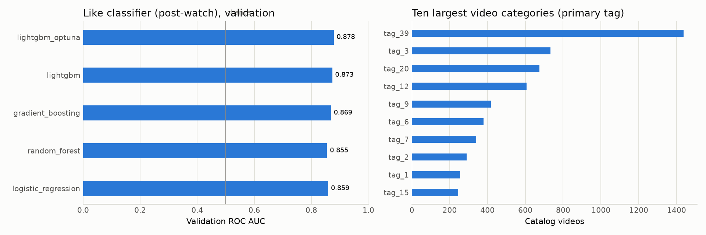

# Experiment report: post-watch like classifier

Results below come from 100,000 real KuaiRand-Pure plays with chronological holdouts. The pre-watch video ranker has its own report: [ranking-report.md](ranking-report.md).

| Model | Validation AUC | Accuracy | Average precision |
| --- | ---: | ---: | ---: |
| logistic_regression | 0.8586 | 0.8987 | 0.3412 |
| random_forest | 0.8548 | 0.9349 | 0.2960 |
| gradient_boosting | 0.8686 | 0.9671 | 0.3623 |
| lightgbm | 0.8732 | 0.8774 | 0.3462 |
| lightgbm_optuna | 0.8784 | 0.8704 | 0.3719 |

Selected by validation AUC: **lightgbm_optuna**.

Held-out test AUC: **0.8659**; average precision: **0.3136** (like rate 2.78%).
Pre-watch ranker (lightgbm_lambdarank): test NDCG@10 **0.4827** vs 0.4205 for the best baseline (logistic_regression); paired bootstrap p = 0.0001.

Probabilities are uncalibrated model scores. Interpret accuracy alongside AUC and average precision: likes are rare, so the majority-only accuracy baseline is high. Offline metrics do not establish online recommendation quality; no online CTR or watch-time uplift was measured.

## Protocol

Plays are ordered by timestamp and split 64,000 / 16,000 / 20,000. Equal timestamps remain together. Label prevalence is reported for every split. Class weighting is applied within training rather than shuffling future records into the past.

History aggregates use plays strictly before each prediction timestamp and are frozen at the training cutoff for validation and test. SVD uses only the first 10% of training history; warmup rows receive zero embeddings. Training and serving reuse the same serialized feature pipeline.

Completion-rate features describe already-observed watch behavior for the like-prediction API. The pre-watch ranker excludes those features.

Optuna and early stopping use validation only. The final model is selected before the held-out test is evaluated. The random seed is 42.

## Reproduction

Run `python -m src.train`. Exact dependency versions are recorded in `requirements-lock.txt`. See `training_results.json`, `optuna_trials.csv`, and `mlflow_runs.json` for the full measurements.
