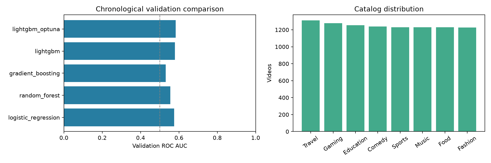

# Experiment report

Results below were generated from the bundled dataset with chronological holdouts.

| Model | Validation AUC | Accuracy | Average precision |
| --- | ---: | ---: | ---: |
| logistic_regression | 0.5751 | 0.5875 | 0.1174 |
| random_forest | 0.5548 | 0.8376 | 0.1204 |
| gradient_boosting | 0.5316 | 0.9067 | 0.1021 |
| lightgbm | 0.5792 | 0.9083 | 0.1268 |
| lightgbm_optuna | 0.5833 | 0.9083 | 0.1218 |

Selected by validation AUC: **lightgbm_optuna**.

Held-out test AUC: **0.5764**; average precision: **0.1147**.
Pre-watch ranking model test AUC: **0.5113**.

Probabilities are uncalibrated model scores. At the default 0.5 decision threshold, test recall is 0.0000; the majority-only accuracy baseline is 0.9105. Interpret accuracy alongside AUC, average precision and recall. Offline discrimination does not establish online recommendation quality. No online CTR, watch-time uplift, or production latency target was measured.

## Protocol

Rows are ordered by timestamp and split 64% / 16% / 20%. Equal timestamps remain together. Label prevalence is reported for every split. Class weighting is applied within training rather than shuffling future records into the past.

History aggregates use events strictly before each prediction timestamp and are frozen at the training cutoff for validation and test. SVD uses only the first 10% of training history; warmup rows receive zero embeddings. Training and serving reuse the same serialized feature pipeline.

Completion-rate features describe already-observed watch behavior for the like-prediction API. A separate pre-watch recommendation model excludes those features.

Optuna and early stopping use validation only. The final model is selected before the held-out test is evaluated. The random seed is 42.

## Reproduction

Run `python -m src.train --trials 5`. Exact dependency versions are recorded in `requirements-lock.txt`. See `training_results.json`, `optuna_trials.csv`, and `mlflow_runs.json` for the full measurements.
