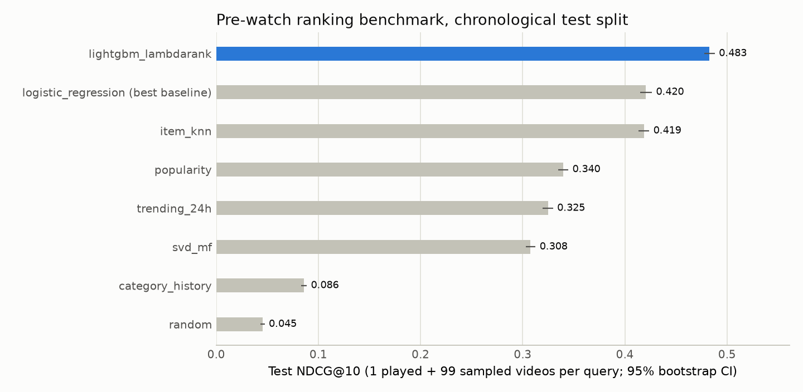
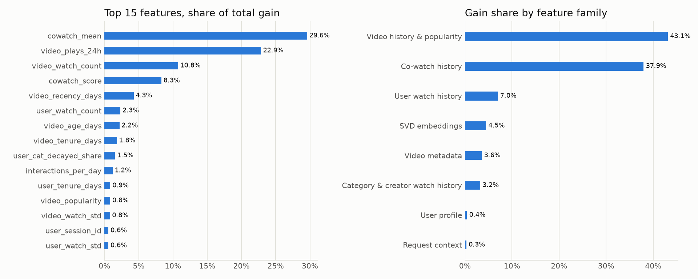

# Ranking report: pre-watch video ranker

## Protocol

- Split: chronological 64K / 16K / 20K plays (train / validation / test).
- Query: one first-time play (user had never played the video before); 100 candidates per query (the played video + 99 sampled videos).
- Negatives: uniform from videos already uploaded at query time, excluding every video the user ever played. Training lists use 10 negatives per query.
- Features: pre-watch only, point-in-time over the full play log (each request sees only earlier plays; learned inputs fit on training plays); observed watch features removed; 235 ranking features.
- Relevance: played = 1, sampled = 0. Metric: NDCG@10 (primary), HR@10, MRR, AUC; mean over queries.
- Model selection: validation NDCG@10 only; test scored once (validation uses 6,000 randomly chosen validation queries).
- Uncertainty: 95% percentile bootstrap over test queries; paired bootstrap over test queries, 10,000 resamples, two-sided.
- Queries: train 63,678, validation 6,000, test 19,942 (all first-time plays in the test split).

## Results (test split, scored once)

| Model | Family | Validation NDCG@10 | Test NDCG@10 [95% CI] | Test HR@10 | Test MRR | Test AUC |
| --- | --- | ---: | ---: | ---: | ---: | ---: |
| **lightgbm_lambdarank** | Tree ensemble (learning to rank) | 0.5276 | 0.4827 [0.4776, 0.4880] | 0.7445 | 0.4136 | 0.9120 |
| logistic_regression (best baseline) | Linear | 0.4982 | 0.4205 [0.4152, 0.4265] | 0.6252 | 0.3674 | 0.8236 |
| item_knn | Collaborative filtering | 0.4618 | 0.4186 [0.4135, 0.4239] | 0.6754 | 0.3532 | 0.8723 |
| popularity | Heuristic | 0.3548 | 0.3397 [0.3347, 0.3447] | 0.5829 | 0.2851 | 0.8651 |
| trending_24h | Heuristic | 0.3722 | 0.3247 [0.3193, 0.3297] | 0.5234 | 0.2772 | 0.7379 |
| svd_mf | Collaborative filtering | 0.3700 | 0.3077 [0.3031, 0.3126] | 0.5106 | 0.2606 | 0.7228 |
| category_history | Content-based | 0.0907 | 0.0859 [0.0829, 0.0887] | 0.1829 | 0.0824 | 0.6213 |
| random | Reference | 0.0459 | 0.0454 [0.0434, 0.0475] | 0.1000 | 0.0518 | 0.4991 |

Best baseline, chosen on validation NDCG@10 before testing: **logistic_regression**.

**lightgbm_lambdarank minus logistic_regression, test NDCG@10 (paired bootstrap over 19,942 queries, 10,000 resamples):** +0.0622 [+0.0590, +0.0656], p = 0.0001.

## Ablations (same tuned parameters, one change each)

| Variant | Features removed | Validation NDCG@10 | Test NDCG@10 | Final minus variant (paired) |
| --- | ---: | ---: | ---: | ---: |
| pointwise_binary_objective | 0 | 0.5281 | 0.4850 | -0.0023 [-0.0042, -0.0005], p = 0.0144 |
| without_user_watch_history | 28 | 0.4043 | 0.3799 | +0.1028 [+0.0985, +0.1071], p = 0.0001 |
| without_svd_embeddings | 101 | 0.5257 | 0.4776 | +0.0052 [+0.0031, +0.0072], p = 0.0001 |

## Sensitivity: histories frozen at the training cutoff

Same trained models, but test features read training plays only, as a service without online feature updates would. Time-relative features (recency, 24-hour plays) then drift outside their training range over the 17-day test window.

| Model | Test NDCG@10, full-log features | Test NDCG@10, frozen features |
| --- | ---: | ---: |
| lightgbm_lambdarank | 0.4827 | 0.4177 |
| item_knn | 0.4186 | 0.3646 |
| svd_mf | 0.3077 | 0.3077 |
| popularity | 0.3397 | 0.3048 |
| trending_24h | 0.3247 | 0.2968 |
| category_history | 0.0859 | 0.0786 |
| random | 0.0454 | 0.0454 |
| logistic_regression | 0.4205 | 0.0140 |

With frozen features, lightgbm_lambdarank minus the strongest baseline under the same features (item_knn): +0.0531 [+0.0498, +0.0565], p = 0.0001.

## Feature importance (LightGBM gain)

| Feature family | Share of gain |
| --- | ---: |
| Video history & popularity | 43.1% |
| Co-watch history | 37.9% |
| User watch history | 7.0% |
| SVD embeddings | 4.5% |
| Video metadata | 3.6% |
| Category & creator watch history | 3.2% |
| User profile | 0.4% |
| Request context | 0.3% |

Gain counts every split, including splits on noisy features, so a family can collect gain without improving NDCG; the ablation table is the causal check.

## Reading the results

In training, the top 1% of videos receive 19.2% of plays and 1.7% of plays repeat a creator the user had already played, so popularity, freshness and per-user watch history all carry signal. Sampled metrics (1 + 99 candidates) rank the true play among random catalog videos; they are not full-catalog metrics and do not establish online engagement lift.

Optuna: 12 trials, best validation NDCG@10 0.5276. Full numbers: `ranking_results.json`, `ranker_optuna_trials.csv`, MLflow experiment `youtube-shorts-ranking`.
